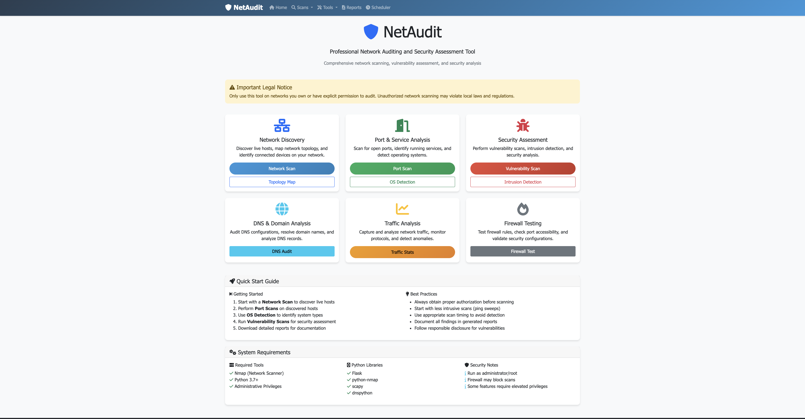

# NetAudit - Network Auditing Web Application

A comprehensive network auditing and security assessment tool built with Flask. 




## ⚡ Quick Start (No Command Line Needed)

You don't need to type any commands. Use the launcher for your system:

**macOS**
1. Download or clone this project.
2. Double-click **`NetAudit.command`**.
3. The first time, if macOS says the file can't be opened, right-click it and choose **Open**, then **Open** again.

**Windows**
1. Download or clone this project.
2. Double-click **`NetAudit.bat`**.
3. If Windows shows a security prompt, choose **More info** then **Run anyway**.

The launcher then:
- Checks for Python 3 and installs Nmap if it's missing (on macOS with Homebrew, or on Windows with winget)
- Sets up the required Python packages (first run only, a few minutes)
- Starts NetAudit and opens it in your browser at http://localhost:5000

Keep the launcher window open while you use NetAudit. Close it to stop the app.

**Before you start, install these if the launcher asks you to:**
- **Python 3**: https://www.python.org/downloads/ (Windows: tick "Add python.exe to PATH")
- **Nmap**: https://nmap.org/download.html
- **Windows only**: Nmap's installer offers to install **Npcap**. Keep that option ticked, as some scans need it.

**Administrator rights:** Some features, such as OS detection and packet capture, need administrator rights. The launcher doesn't request them. NetAudit shows a warning when it isn't running with them.

> Only scan networks you own or have written permission to test.

## 🚀 Features

### Network Discovery & Analysis
- **Network Scanning**: Discover live hosts on your network
- **Port Scanning**: Identify open ports and running services
- **OS Detection**: Fingerprint operating systems
- **Network Topology**: Visualize network structure with interactive graphs

### Security Assessment
- **Vulnerability Scanning**: Automated and custom vulnerability detection
- **Intrusion Detection**: Compare network state against known legitimate hosts
- **Firewall Testing**: Test Windows firewall rules and port accessibility

### Traffic Analysis
- **Packet Capture**: Real-time network traffic analysis
- **Protocol Distribution**: Visual breakdown of network protocols
- **Traffic Statistics**: Detailed packet information and analysis

### DNS & Domain Analysis
- **DNS Auditing**: Domain name resolution and record analysis
- **Domain Reconnaissance**: Security-focused DNS investigation

### Reporting & Documentation
- **PDF Reports**: Professional, downloadable reports for all scans
- **JSON Export**: Machine-readable data export
- **Report Management**: Centralized report storage and access

### Task Scheduling
- **Automated Scheduling**: Schedule audit tasks to run at specific times
- **Background Execution**: Tasks run automatically in the background
- **Result Storage**: All scheduled task results are saved and accessible
- **Email Notifications**: Optional email tracking for scheduled tasks

## 📋 Prerequisites

### System Requirements
- **Operating System**: Windows (for full functionality), Linux/macOS (limited features)
- **Python**: Version 3.7 or higher
- **Administrative Privileges**: Required for packet capture and some scans
- **Nmap**: Network scanning tool (must be installed separately)

### Network Requirements
- Access to target networks (with proper authorization)
- Internet connectivity for DNS auditing
- Administrative privileges for packet capture functionality

## 🛠️ Installation

### Step 1: Clone or Download
```bash
# If using git
git clone <repository-url>
cd NetAudit

# Or download and extract the ZIP file
```

### Step 2: Install Dependencies
```bash
# Install required Python packages
pip install -r requirements.txt
```

### Step 3: Install Nmap
**Windows:**
- Download and install Nmap from: https://nmap.org/download.html
- Ensure `nmap.exe` is in your system PATH

**Linux (Ubuntu/Debian):**
```bash
sudo apt-get update
sudo apt-get install nmap
```

**macOS:**
```bash
brew install nmap
```

### Step 4: Set Up Database (Required for Task Scheduling)
```bash
# Set up the SQLite database for task scheduling
python setup_database.py

# (Optional) Test the database setup
python test_database.py
```

### Step 5: Verify Installation
```bash
# Check Python version
python --version

# Check Nmap installation
nmap --version

# Test the Flask app
python webapp.py
```

## 🚀 Running the Application

### Standard Launch
```bash
python webapp.py
```

### Production Deployment
For production use, consider using a WSGI server like Gunicorn:
```bash
pip install gunicorn
gunicorn -w 4 -b 0.0.0.0:5000 webapp:app
```

### Access the Application
Once running, access the web application at:
- **Local**: http://localhost:5000
- **Network**: http://[your-ip]:5000

### Why Docker Is Not Supported
NetAudit runs directly on your machine, not in a container. Network scans
(ping sweeps, port scans, OS detection, packet capture) need to see your real
LAN. On macOS and Windows, Docker runs containers inside a virtual machine
with its own network, so they cannot see your devices: every address appears
as "up" with no MAC address. Linux host networking would fix this, but the
project does not ship a Docker setup for it. Install and run it natively
as described above.

## 📖 Usage Guide

### Getting Started
1. **Launch the Application**: Run `python webapp.py`
2. **Open Web Browser**: Navigate to http://localhost:5000
3. **Review Legal Notice**: Ensure you have permission to scan target networks
4. **Choose Scan Type**: Select from the available scanning options

### Scan Types

#### Network Scan
- **Purpose**: Discover live hosts on a network
- **Input**: Subnet in CIDR notation (e.g., 192.168.1.0/24)
- **Output**: List of discovered hosts with IP and MAC addresses
- **Use Cases**: Network discovery, asset inventory

#### Port Scan
- **Purpose**: Identify open ports and services
- **Input**: Target IP address
- **Output**: Table of ports, states, services, and versions
- **Use Cases**: Service enumeration, security assessment

#### OS Detection
- **Purpose**: Identify operating system of target hosts
- **Input**: Target IP address
- **Output**: Detected operating system information
- **Use Cases**: Asset fingerprinting, vulnerability assessment

#### Vulnerability Scan
- **Purpose**: Automated security vulnerability detection
- **Input**: Target IP address, scan mode (auto/custom)
- **Output**: List of potential vulnerabilities
- **Use Cases**: Security assessment, penetration testing

#### DNS Audit
- **Purpose**: Analyze DNS records and domain information
- **Input**: Domain name
- **Output**: DNS records and resolution information
- **Use Cases**: Domain reconnaissance, DNS security assessment

#### Traffic Analysis
- **Purpose**: Capture and analyze network packets
- **Input**: Number of packets to capture
- **Output**: Protocol distribution and packet details
- **Use Cases**: Network monitoring, traffic analysis

#### Firewall Test
- **Purpose**: Test Windows firewall rules
- **Input**: None (automatic)
- **Output**: Firewall rule status and accessibility
- **Use Cases**: Firewall configuration validation

#### Network Topology
- **Purpose**: Visualize network structure
- **Input**: Subnet to map
- **Output**: Interactive network graph
- **Use Cases**: Network documentation, topology visualization

#### Intrusion Detection
- **Purpose**: Detect unauthorized hosts on network
- **Input**: Subnet and list of legitimate hosts
- **Output**: List of potential intrusions
- **Use Cases**: Security monitoring, intrusion detection

#### Task Scheduling
- **Purpose**: Automate audit tasks to run at specified times
- **Input**: Task type, schedule time, and task-specific parameters
- **Output**: Scheduled execution and result storage
- **Use Cases**: Regular security audits, automated monitoring, compliance reporting

### Report Generation
- All scans generate downloadable PDF reports
- Reports include timestamps, scan parameters, and detailed results
- Access all reports via the Reports page
- JSON export available for machine processing

### Task Scheduling
- **Schedule Tasks**: Use the Scheduler page to set up automated audit tasks
- **Choose Task Type**: Select from all available scan types
- **Set Schedule Time**: Pick when the task should run
- **Configure Parameters**: Set task-specific parameters (IP addresses, domains, etc.)
- **Monitor Results**: View scheduled tasks and their results
- **Download Reports**: Access PDF reports for completed scheduled tasks
- **Manage Jobs**: Remove or modify scheduled tasks as needed

#### Scheduling Best Practices
- Schedule intensive scans during off-peak hours
- Use email notifications for important tasks
- Regularly review and clean up old scheduled tasks
- Test scheduled tasks with small parameters first
- Monitor system resources during scheduled executions

## ⚖️ Legal and Ethical Considerations

### Important Legal Notice
**ONLY use this tool on networks you own or have explicit permission to audit.**

### Unauthorized Use is Prohibited
- Network scanning without permission may violate local laws
- Unauthorized access attempts are illegal in most jurisdictions
- Always obtain written permission before conducting security assessments

### Responsible Use Guidelines
1. **Authorization**: Obtain proper authorization before scanning
2. **Scope**: Stay within agreed-upon testing boundaries
3. **Impact**: Minimize disruption to network operations
4. **Documentation**: Maintain detailed logs of all activities
5. **Disclosure**: Follow responsible disclosure practices for vulnerabilities

## 🔧 Configuration

### Security Settings
- Change the Flask secret key in `webapp.py` for production use
- Configure firewall rules to restrict access if needed
- Use HTTPS in production environments

### Customization
- Modify scan parameters in the utility functions
- Customize report templates and styling
- Add additional vulnerability databases
- Extend functionality with new scan types

## 🗄️ Database Management

### Task Scheduler Database
The application uses a SQLite database to store scheduled tasks. The database file is automatically created when you run the setup script.

#### Database Files
- `scheduled_jobs.db` - Main database for scheduled tasks
- `scheduled_results/` - Directory containing task results and reports

#### Database Setup
```bash
# Initial setup (run once)
python setup_database.py

# Test database functionality
python test_database.py
```

#### Database Maintenance
- The database is automatically managed by APScheduler
- No manual maintenance required
- Database file can be safely backed up or moved
- To reset the database, delete `scheduled_jobs.db` and run `setup_database.py`

#### Database Location
- Database file: `./scheduled_jobs.db` (relative to application directory)
- Results directory: `./scheduled_results/` (created automatically)

## 🐛 Troubleshooting

### Common Issues

#### Permission Errors
**Problem**: "Permission denied" errors during scans
**Solution**: Run the application with administrative privileges

#### Nmap Not Found
**Problem**: "nmap command not found"
**Solution**: Install Nmap and ensure it's in your system PATH

#### Packet Capture Fails
**Problem**: Traffic analysis doesn't capture packets
**Solution**: Run with administrative privileges and check firewall settings

#### Port Scan Takes Too Long
**Problem**: Port scans are very slow
**Solution**: Reduce scan range or adjust timing parameters

#### Network Scan Fails With "Failed to fetch"
**Problem**: The Network Scan page shows "Network error: Failed to fetch" and never returns results
**Solution**: The scan is taking too long, usually because nmap is doing reverse-DNS lookups for every address. The app runs `nmap -sn -n` to avoid this. Make sure you have the latest `webapp.py`, and check the server logs for errors.

#### Scheduler Database Errors
**Problem**: "Database not found" or scheduler initialization fails
**Solution**: Run `python setup_database.py` to create the database

#### Task Scheduling Not Working
**Problem**: Cannot schedule tasks or scheduler fails to start
**Solution**: 
1. Run `python setup_database.py` to ensure database exists
2. Run `python test_database.py` to verify setup
3. Check that all dependencies are installed: `pip install -r requirements.txt`

### Performance Optimization
- Use smaller subnet ranges for faster network scans
- Adjust Nmap timing templates for better performance
- Limit packet capture count for traffic analysis
- Consider running scans during off-peak hours

## 📁 Project Structure

```
NetAudit/
├── webapp.py                 # Main Flask application
├── scheduler.py              # Task scheduling system
├── requirements.txt          # Python dependencies
├── README_webapp.md          # This file
├── templates/                # HTML templates
│   ├── base.html            # Base template with navigation
│   ├── index.html           # Homepage
│   ├── network_scan.html    # Network scanning page
│   ├── port_scan.html       # Port scanning page
│   ├── vulnerability_scan.html # Vulnerability scanning page
│   ├── dns_audit.html       # DNS auditing page
│   ├── traffic_stats.html   # Traffic analysis page
│   ├── firewall_test.html   # Firewall testing page
│   ├── network_topology.html # Network topology page
│   ├── intrusion_detection.html # Intrusion detection page
│   ├── os_detection.html    # OS detection page
│   ├── scheduler.html       # Task scheduling page
│   └── reports.html         # Reports listing page
├── static/                  # Static files (created automatically)
├── reports/                 # Generated reports (created automatically)
├── scheduled_results/       # Scheduled task results (created automatically)
├── vuln_db.json            # Vulnerability database
└── lib/                    # JavaScript libraries (from original)
```

## 🤝 Contributing

### Development Setup
1. Fork the repository
2. Create a development branch
3. Install dependencies: `pip install -r requirements.txt`
4. Make your changes
5. Test thoroughly
6. Submit a pull request

### Areas for Contribution
- Additional scan types and techniques
- Enhanced vulnerability databases
- Improved user interface and experience
- Better error handling and logging
- Performance optimizations
- Security enhancements

## 📄 License

This project is intended for educational and authorized security testing purposes only. Users are responsible for complying with all applicable laws and regulations.

## 🆘 Support

### Getting Help
- Review this README thoroughly
- Check the troubleshooting section
- Verify system requirements and dependencies
- Ensure proper permissions and authorization

### Reporting Issues
When reporting issues, please include:
- Operating system and version
- Python version
- Complete error messages
- Steps to reproduce the issue
- Network configuration details (if relevant)

## 🔮 Future Enhancements

### Planned Features
- Multi-threaded scanning for better performance
- Database integration for scan history
- User authentication and access control
- API endpoints for programmatic access
- Advanced reporting and analytics
- Integration with threat intelligence feeds
- Mobile-responsive design improvements

### Community Requests
- Support for additional operating systems
- Integration with other security tools
- Custom vulnerability databases
- Automated scheduling of scans
- Real-time alerting and notifications

---

**Remember**: Always use this tool responsibly and only on networks you own or have explicit permission to audit. Unauthorized network scanning is illegal and unethical. 
